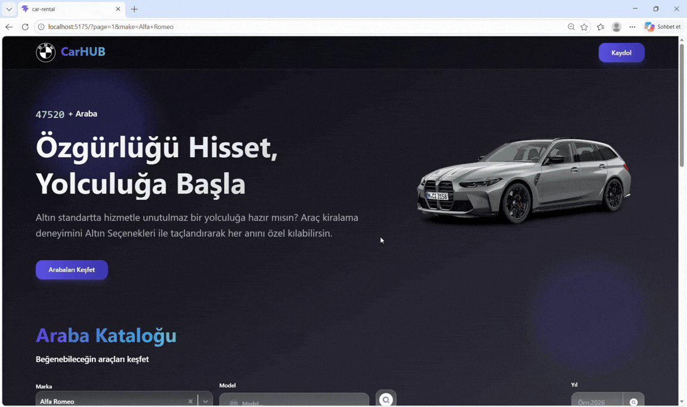

# 🚗 CarHub - Car Rental

CarHub is a modern and responsive car rental catalog application built with React and TypeScript. It provides an intuitive interface for browsing vehicles, searching by brand and model, filtering by year, and exploring detailed vehicle information.

## ✨ Features

- 🚘 **Dynamic Vehicle Listing:** Browse vehicles using data from the OpenDataSoft API.
- 🔍 **Brand & Model Search:** Search and filter vehicles with React Select.
- 📅 **Year Filtering:** Filter vehicles by production year with URL parameter synchronization.
- 📄 **Pagination:** Navigate through vehicle listings with pagination support.
- 🪟 **Vehicle Details Modal:** Explore detailed vehicle information through animated modal windows.
- 🖼️ **Dynamic Vehicle Images:** Display vehicle images generated through the Imagin Studio CDN.
- 💰 **Estimated Daily Rental Price:** Calculate estimated rental prices based on vehicle specifications such as year, engine size, fuel type, drivetrain, and brand.
- 📱 **Responsive Design:** Optimized user experience across desktop, tablet, and mobile devices.

## 🛠️ Technologies Used

| Technology        | Description                          |
| ----------------- | ------------------------------------ |
| React             | Component-based UI development       |
| TypeScript        | Type-safe development                |
| Vite              | Fast development and build tooling   |
| Tailwind CSS      | Responsive and utility-first styling |
| Motion            | Animations and transition effects    |
| React Router DOM  | Routing and URL parameter management |
| React Select      | Interactive brand selection          |
| rc-pagination     | Pagination functionality             |
| Axios / Fetch API | HTTP requests and API integration    |

## 🌍 API & Data Sources

- **Vehicle Data:** Retrieved from the OpenDataSoft `all-vehicles-model` dataset.
- **Vehicle Images:** Generated through Imagin Studio CDN using vehicle brand, model, year, color, and angle parameters.
- **URL-Based Filtering:** Search and filter parameters such as `make`, `model`, `year`, and `page` are synchronized with the URL.

## 📂 Project Highlights

- Reusable and modular React component architecture.
- External API integration and dynamic data rendering.
- TypeScript-based type safety.
- URL-driven filtering and navigation.
- Animated vehicle detail interactions.
- Responsive and user-friendly interface.

## 📸 Project Preview

